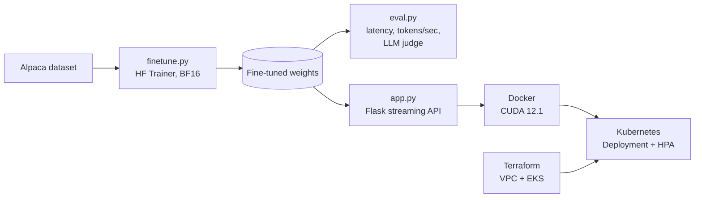

# Raga

**End-to-end LLM fine-tuning, streaming inference API, and Kubernetes deployment.**

[](https://www.python.org/)
[](https://pytorch.org/)
[](https://huggingface.co/docs/transformers)
[](https://www.docker.com/)
[](https://www.terraform.io/)
[](https://kubernetes.io/)
[](LICENSE)

Raga takes a small open LLM ([Qwen3-0.6B](https://huggingface.co/Qwen/Qwen3-0.6B)) from raw instruction data to a GPU-backed, token-streaming HTTP service: fine-tune, evaluate, containerize, provision infrastructure, and deploy.

## Highlights

- **Fine-tuning** on a slice of [Alpaca](https://huggingface.co/datasets/tatsu-lab/alpaca) with the HuggingFace `Trainer` (BF16, effective batch size 16, 2 epochs).
- **Streaming inference API** (Flask) that emits tokens as they are generated, using `TextIteratorStreamer` and a background generation thread.
- **Automated evaluation**: per-sample latency and tokens/sec, plus an LLM-as-a-judge pass (local Ollama) scoring relevance, semantic similarity, completeness, and factual alignment.
- **Containerized** on an NVIDIA CUDA 12.1 base image, with a Compose file for GPU passthrough.
- **Infrastructure as code**: Terraform for an AWS VPC and EKS cluster (LocalStack-friendly for local testing).
- **Kubernetes manifests**: Deployment, Service, ConfigMap, and CPU-based HPA with GPU resource requests.

## Architecture



## Repository layout

```
.
├── app.py               # Flask streaming inference server (POST /generate)
├── model_loader.py      # Loads Qwen3-0.6B model and tokenizer
├── finetune.py          # Fine-tuning pipeline
├── eval.py              # Benchmark + LLM-as-a-judge evaluation
├── test.py              # Streaming client for smoke testing
├── Dockerfile           # CUDA 12.1 + Python 3.12 + uv
├── docker-compose.yaml  # GPU-enabled local run
├── requirements.txt
├── k8s/
│   └── deployment.yaml  # Namespace, ConfigMap, Deployment, Service, HPA
└── infra/terraform/     # AWS VPC + EKS (LocalStack by default)
```

## Quick start

**Requirements:** Python 3.10+, optionally an NVIDIA GPU with CUDA 12.1+ drivers. Ollama is only needed for `eval.py`.

```bash
git clone https://github.com/inglevivek/raga.git
cd raga

python -m venv venv
source venv/bin/activate        # Windows: .\venv\Scripts\Activate.ps1
pip install uv && uv pip install -r requirements.txt
```

### 1. Fine-tune

```bash
python finetune.py              # writes weights to ./ragarag_finetuned
```

| Setting | Value |
| :-- | :-- |
| Base model | `Qwen/Qwen3-0.6B` |
| Data | first 1,000 Alpaca examples, 80/20 train/eval split |
| Sequence length | 128 (padded/truncated) |
| Batch | 2 per device x 8 gradient-accumulation steps |
| Epochs / LR | 2 / 2e-5 |
| Precision | BF16 |

### 2. Evaluate

```bash
ollama pull qwen3.5:2b && ollama serve
python eval.py
```

Reports latency and tokens/sec per sample, then has the judge model grade each answer against the Alpaca reference on four 1-10 criteria.

### 3. Serve

```bash
python app.py                   # http://localhost:5000
```

```bash
curl -N -X POST http://localhost:5000/generate \
  -H "Content-Type: application/json" \
  -d '{"prompt": "Explain quantum computing in simple terms."}'
```

The response is `text/plain` with chunked transfer; tokens arrive as they are produced. `python test.py` does the same from Python.

## Docker

```bash
docker build -t raga:v1 .
docker run --gpus all -p 5000:5000 raga:v1
# or
docker-compose up --build
```

Requires the NVIDIA Container Toolkit for GPU access.

## Infrastructure (Terraform)

`infra/terraform` provisions a VPC and an EKS cluster (Kubernetes 1.33). The provider targets [LocalStack](https://localstack.cloud/) at `http://localhost:4566` by default; change `variables.tf` to target real AWS.

```bash
cd infra/terraform
terraform init
terraform plan
terraform apply
```

## Kubernetes

`k8s/deployment.yaml` defines a `raga-mlops` namespace, a ConfigMap, a 2-replica rolling-update Deployment requesting one `nvidia.com/gpu` per pod, a LoadBalancer Service on port 80, and an HPA (2-5 replicas at 80% CPU).

```bash
# GPU scheduling needs the NVIDIA GPU Operator or device plugin
helm repo add nvidia https://helm.ngc.nvidia.com/nvidia && helm repo update
helm install --wait --generate-name -n gpu-operator --create-namespace nvidia/gpu-operator

aws eks update-kubeconfig --region us-east-1 --name Raga
kubectl apply -f k8s/deployment.yaml
kubectl get pods -n raga-mlops
```

## Notes

- Fine-tuned weights, `mlflow.db`, and Terraform state are intentionally **not** committed (see `.gitignore`); run `finetune.py` to regenerate them.
- Evaluation covers 20 held-out samples with a small local judge model, so treat scores as a sanity check rather than a benchmark.

## License

Released under the [MIT License](LICENSE). Base model weights are provided by Qwen under their own license.
